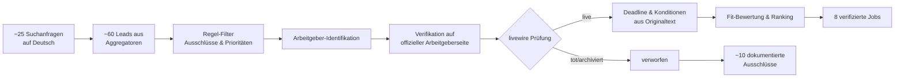

```
flowchart LR
    A[~25 Suchanfragen<br/>auf Deutsch] --> B[~60 Leads aus<br/>Aggregatoren]
    B --> C[Regel-Filter<br/>Ausschlüsse & Prioritäten]
    C --> D[Arbeitgeber-Identifikation]
    D --> E[Verifikation auf<br/>offizieller Arbeitgeberseite]
    E --> F{livewire Prüfung}
    F -- live --> G[Deadline & Konditionen<br/>aus Originaltext]
    F -- tot/archiviert --> H[verworfen]
    G --> I[Fit-Bewertung & Ranking]
    I --> J[8 verifizierte Jobs]
    H --> K[~10 dokumentierte<br/>Ausschlüsse]
```

Here's the full pipeline I ran, step by step — this is exactly what the daily 8:00 task does too.



## 1. Extraction — Suchanfragen auf Deutsch (~25 Queries)

**Breite Suche (8 science angles):** z.B. "RAG LLM Python Entwickler Stellen Berlin", "Datenbank Entwickler PostgreSQL Stellen Berlin Potsdam Leipzig", "Datenvisualisierung Entwickler Python Stellenangebote Berlin", "Forschungssoftware Entwickler Stellen Berlin".

**Vertical queries (4):** "Springer Nature Data Engineer Stellen Berlin", "Verlag Data Engineer Daten Stellen Berlin" (publishing/news, Berlin only).

**Zielarbeitgeber direkt geöffnet:** GFZ (helixjobs), UFZ (ufz.de/jobs), BAM (recruiting.bam.de), Museumsbund-Stellenliste, Tagesspiegel-Portal, HZDR, Springer Nature Workday, De Gruyter (deutsche Karriereseite).

**Berliner Unis**: fu berlin (https://www.fu-berlin.de/universitaet/beruf-karriere/jobs/wiss/gesamtliste/index.rss), tu berlin (https://www.jobs.tu-berlin.de/stellenausschreibungen.atom), BHT (https://stellenticket.bht-berlin.de/en/job-offers.atom) und versuche, die stellensiten der HU Berlin und der HTW zu crawlen

## 2. Lead collection — Aggregatoren sind nur Rohmaterial

Resultiert: ~60 Kandidaten, fast alle zunächst von StepStone, Indeed, Glassdoor, kimeta, baito, StudySmarter, databerlin.net. **Diese galten nie als Beweis**, sondern nur als Hinweise ("leads").

## 3. Rule-based filtering (before verification)

- **Harte Ausschlüsse:** Axel Springer, LiveEO, ICEYE, Uniklinik Leipzig (Medizin nur Berlin), Niederlande, reine PhD-Stellen, Sysadmin/HPC, Praktika/Werkstudenten.
- **Prioritäten-Screen:** RAG, Visualization, ML, Scrum, Python, DB hoch; Remote Sensing normal gewichtet.
- Beispiel: Reply "Senior Graph AI Engineer" und PTA "KI-Entwickler LLM & RAG" wurden aus dem RAG-Angle hochgeprio­ritisiert; HZDR-Gruppenleiter HPC direkt verworfen.

## 4. Employer identification — wer steckt wirklich dahinter?

Jeder Aggregator-Listing wurde dem tatsächlichen Arbeitgeber zugeordnet: "Senior Data Engineer Berlin" → WARDOW GmbH; "AI Engineer LLM + Knowledge Graphs" (StepStone: "GAIA Technologies") → tatsächlich Pinnipedia Technologies; "Data Scientist AI & Analytics" → Verlag Der Tagesspiegel.

## 5. Verification — offizielle Quelle öffnen und lesen

Jeder Lead wurde auf der **eigenen Seite des Arbeitgebers** geöffnet: Karriereportale (karriere.pta-gruppe.com, jobs.tagesspiegel.de, jobs.dlr.de, recruiting.bam.de), offizielle ATS (join.com, Onlyfy, greenhouse, helixjobs, b-ite) oder Domain-PDFs (uniklinikum-dresden.de). Sprachregel: deutsche Version bevorzugt; englische Seite nur, wo keine deutsche existiert (Planet).

**Konkrete Entscheidungen aus diesem Schritt:**
- PTA RAG-Stelle → offizielle Seite geöffnet, vollständig lesbar → ✅ verifiziert
- Pinnipedia "AI Engineer LLM+KG" → join.com: "OLD APPLICATION — archived 6 months ago" → ❌
- DLR 5644 (Datenwissenschaftler) → offizielles Portal: "derzeit nicht verfügbar" → ❌ (Aggregatoren zeigten sie als aktuell)
- BAM RSE 279 → "Stellenanzeige nicht gefunden" → ❌
- WARDOW → "archiviert vor 1 Jahr" → ❌

## 6. Liveness & deadline extraction from official text

Aus dem geöffneten Originaltext: Bewerbungsfrist / Einsendeschluss (z.B. UFZ D-TWINS: 19.11.2026; GFZ EnMAP: 04.11.2026), Anstellungsart, TV-L/TVöD, Homeoffice-Anteil. Frist in der Vergangenheit = raus (Beispiel: NCT Dresden — PDF online, aber Frist 21.05.2026 abgelaufen). Kein offizieller Text lesbar = unverifiziert = nicht gemeldet (Beispiel: TIB Hannover, Anubis-Bot-Schutz).

## 7. Fit assessment & ranking

Jede verifizierte Stelle gegen dein Profil geprüft (MSc, kein PhD, Python/R, ML, ETL, DB, hybrid, deine Städte) und nach den neuen Prioritäten gerankt — daher PTA (RAG) und Tagesspiegel (SQL/Power BI) oben, GFZ EnMAP trotz Dringlichkeit erst auf Platz 4, und ehrliche "Schwach-Passungs"-Vermerke bei IfM SPK und De Gruyter statt Streichung.

## 8. Reporting

Ranking mit Titel, Ort, Frist, Keywords, Offiziell-Link; die ~10 verworfenen Leads mit Grund aufgelistet, damit du siehst, was geprüft wurde und warum es nicht durchkam. Falsch-Positive-Freiheit > Listenlänge.

Kurzfassung des Funnels: **~25 Queries → ~60 Leads → ~20 offizielle Seiten geöffnet → 8 verifiziert live → ranked**, mit ~10 dokumentierten Ablehnungen (tot, archiviert, Frist abgelaufen, PhD nötig, unverifizierbar).